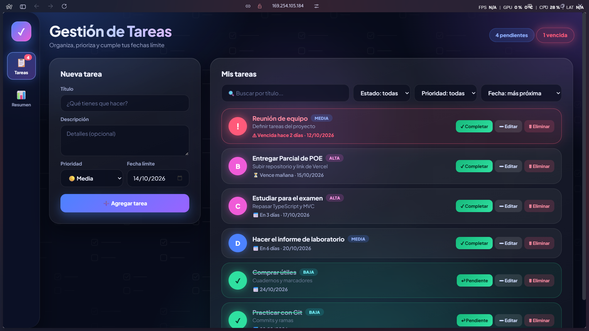
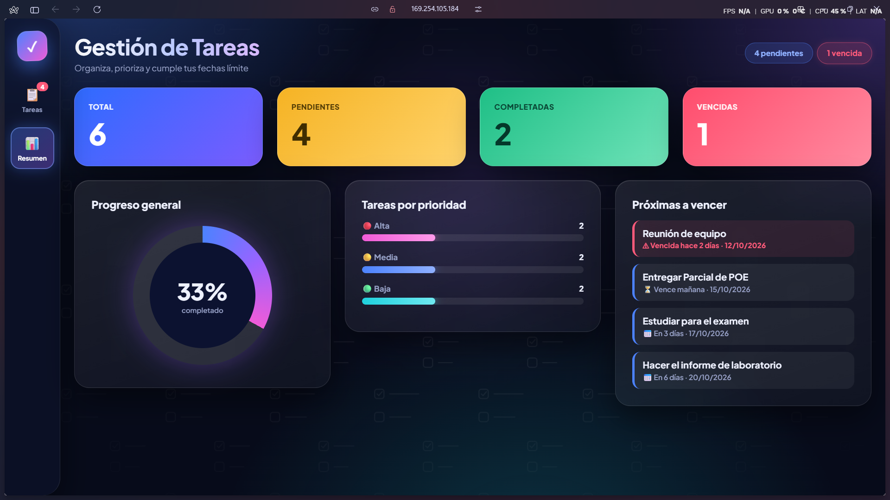
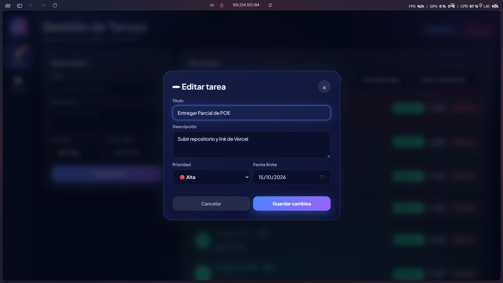
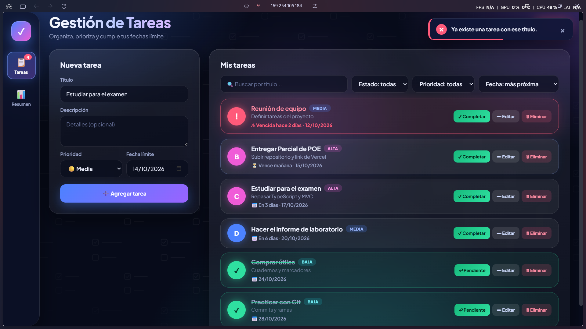
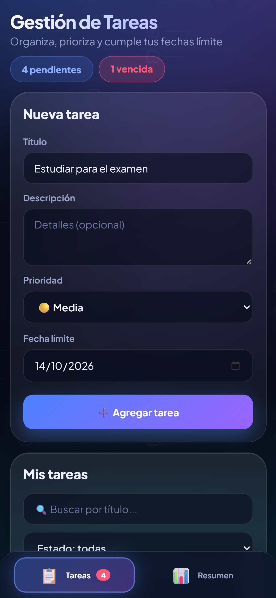

# ✅ Gestión de Tareas

**Laboratorio #2 (Proyecto 1) · Actualización Parcial 2** | Programación Orientada a Eventos
**Autor:** Jefferson Requeno| **Carnet:** u20250779 | **Fecha:** Octubre 2026

🌐 **Demo en línea:** https://lista-tareas-sand-xi.vercel.app/
📦 **Repositorio:** https://github.com/JeffersonUU7/lista-tareas.git

Aplicación web para gestionar tareas con **fecha límite y prioridad**, desarrollada con **TypeScript** y arquitectura **MVC**. Guarda los datos en `localStorage`, ofrece dos vistas (Tareas y Resumen) y un diseño responsive de pantalla completa con tema oscuro.

## 🖼️ Capturas de pantalla

### Vista de tareas (con una tarea vencida en rojo)


### Resumen y estadísticas


### Edición de tareas


### Validaciones y notificaciones


### Versión móvil


---

## 🚀 Cómo ejecutar el proyecto

### Requisitos
- **Node.js** 18 o superior (incluye `npm`): https://nodejs.org
- Navegador moderno (Chrome, Edge o Firefox actualizado)
- Internet solo para la tipografía de Google Fonts (sin internet funciona con otra fuente)

Verificar: `node -v` y `npm -v`

### Instalación y ejecución
```bash
git clone https://github.com/JeffersonUU7/lista-tareas.git
cd lista-tareas
npm install
npm start
```
Abrir en el navegador: **http://localhost:3000**

> `npm start` compila el TypeScript (carpeta `dist/`) y levanta el servidor local.

### Comandos
| Comando | Qué hace |
|---|---|
| `npm install` | Instala dependencias (TypeScript y serve) |
| `npm run build` | Compila TypeScript a `dist/` |
| `npm run watch` | Recompila al guardar cambios |
| `npm start` | Compila y levanta el servidor en el puerto 3000 |

### ⚠️ Importante
- **No abrir `index.html` con doble clic**: los módulos ES requieren un servidor (`npm start`).
- Si el puerto 3000 está ocupado, `serve` elige otro automáticamente y lo muestra en la terminal; también se puede forzar con `npx serve . -l 3001`.
- Si se ve una versión vieja, refrescar con `Ctrl + F5`.
- Los datos se guardan en el `localStorage` del navegador, independiente por dominio, puerto y navegador.

### Solución de problemas
| Problema | Solución |
|---|---|
| `'npm' no se reconoce` | Instalar Node.js y reiniciar la terminal |
| Pantalla en blanco | Usar `npm start`, no doble clic en el HTML |
| Puerto en uso | `npx serve . -l 3001` |
| Cambios no se reflejan | `npm run build` y `Ctrl + F5` |
| "Agregar" no responde | Abrir `F12` → Console y revisar el error |

---

## ☁️ Despliegue en Vercel
1. Subir el repositorio a GitHub.
2. En https://vercel.com: **Add New → Project** e importar el repositorio.
3. Framework Preset: **Other** (usa `vercel.json`: compila con `npm run build` y publica la raíz).
4. **Deploy**. Cada `git push` redespliega automáticamente.

---

## ✅ Requerimientos del Parcial 2

| Código | Requerimiento | Implementación |
|---|---|---|
| RF-01 | Fecha límite | Campo `fechaLimite` en `Tarea` y en los formularios |
| RF-02 | Prioridad alta/media/baja | Tipo `Prioridad` y selector |
| RF-03 | Editar tareas | `renderEditForm()` (modal) + `handleUpdate()` + `updateTarea()` |
| RF-04 | Eliminar con confirmación | `handleDelete()` + `deleteTarea()` |
| RF-05 | Buscar por título | `searchTareas()` + `handleSearch()` |
| RF-06 | Filtrar por estado y prioridad | `filterTareas()` (combinable con la búsqueda) |
| RF-07 | Ordenar por fecha o prioridad | `sortTareas()` (4 modos) |
| RF-08 | Guardar en localStorage | `StorageService` |
| RF-09 | Contador de pendientes | `renderCounter()` |
| Reto | Vencidas en rojo | `estaVencida()` + estilos; se actualiza cada minuto |

### Funcionalidades adicionales
- **Dos vistas:** Tareas y Resumen
- **Notificaciones** con auto-cierre y barra de progreso
- **Resumen:** total, pendientes, completadas, vencidas, anillo de progreso, tareas por prioridad y próximas a vencer
- **Diseño responsive** para laptop, tablet y celular, con tema oscuro y fondo temático
- Compatible con datos guardados del Laboratorio #2

### Validaciones
| Tipo | Regla |
|---|---|
| Formato | El título debe contener al menos una letra; la fecha debe ser válida y existir en el calendario |
| Rangos | Título de 3 a 60 caracteres; descripción máximo 200; fecha no pasada (al crear o cambiarla) ni mayor a 5 años |
| Duplicados | No se permiten dos tareas con el mismo título (sin distinguir mayúsculas) |
| Obligatorios | Título, prioridad y fecha |

---

## 🏗️ Arquitectura MVC

| Capa | Archivo | Responsabilidad |
|---|---|---|
| **Model** | `src/models/Tarea.ts` | Entidad `Tarea`, sus validaciones y reglas (vencida, días restantes) |
| **Model** | `src/models/TareaModel.ts` | Colección de tareas: CRUD, búsqueda, filtros, orden y estadísticas |
| **View** | `src/views/TareaView.ts`, `index.html`, `styles.css` | Renderizado, formularios, modal, notificaciones y eventos del DOM |
| **Controller** | `src/controllers/TareaController.ts` | Recibe eventos de la vista, usa el modelo y ordena actualizar la vista |
| **Service** | `src/services/StorageService.ts` | Lectura y escritura en `localStorage` |

**Flujo:** Vista (evento) → Controlador → Modelo (valida y guarda mediante StorageService) → Controlador → Vista (renderiza).

### Cambios respecto al Laboratorio #2
- `Tarea` añade: `prioridad`, `fechaLimite`
- `TareaModel` (nuevo) añade: `updateTarea()`, `deleteTarea()`, `searchTareas()`, `filterTareas()`
- `TareaView` añade: `renderEditForm()`, `renderCounter()`
- `TareaController` añade: `handleUpdate()`, `handleDelete()`, `handleSearch()`

### TypeScript aplicado
- Clases con modificadores `public`, `private` y `readonly`
- Interfaces: `ITarea`, `DatosTarea`, `Criterios`, `Resumen`
- Tipos de unión: `Prioridad`, `FiltroEstado`, `FiltroPrioridad`, `Orden`
- `Record<Prioridad, number>` para el peso del ordenamiento
- Métodos estáticos, genéricos (`el<T>`) y modo `strict`

---

## 📁 Estructura del proyecto

```
lista-tareas/
├── index.html
├── package.json
├── tsconfig.json
├── vercel.json
├── README.md
├── docs/                  (capturas de pantalla)
│   ├── tareas.png
│   ├── estadisticas.png
│   ├── edicion.png
│   ├── validacion.png
│   └── movil.png
├── dist/                  (JavaScript compilado)
└── src/
    ├── main.ts
    ├── models/
    │   ├── Tarea.ts
    │   └── TareaModel.ts
    ├── views/TareaView.ts
    ├── controllers/TareaController.ts
    ├── services/StorageService.ts
    └── styles/styles.css
```